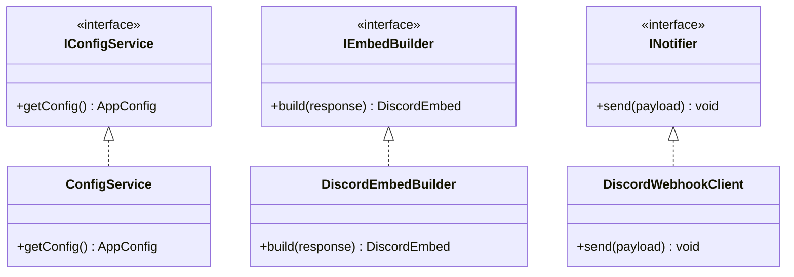

# Ban Appeal Notifier アーキテクチャ仕様書

本ドキュメントでは、Ban Appeal Notifier の内部設計、コンポーネント構成、および設計方針について記述します。

---

## 設計方針

本プロジェクトは Google Apps Script (GAS) 環境におけるメンテナンス性と型安全性を高めるため、以下の設計方針を採用しています。

- **TypeScript パターン**: GAS の単一グローバルスコープと適合させるため `namespace` パターンを活用。
- **インターフェース分離 (SOLID原則)**: 設定読み込み、Embed構築、通知送信の各責務をインターフェースとして分離。

---

## コンポーネント構成

### 1. IConfigService (`src/config.ts`)
- 環境変数 (`.env` 経由の `src/env.ts`) および `PropertiesService` からの設定取得を担当。Webhook URL は秘密なので `PropertiesService` からだけ読む。

### 2. IEmbedBuilder (`src/builder.ts`)
- Google フォームの回答データから Discord Webhook 用の Embed 構造体を構築。

### 3. INotifier (`src/notifier.ts`)
- Discord Webhook への HTTP リクエスト送信およびエラーハンドリングを担当。
