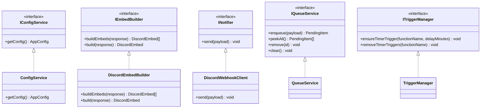

# Ban Appeal Notifier の内部の作り

この文書は、Ban Appeal Notifier の内部の設計、部品の分け方、考え方を書きます。使い方は [README.md](README.md) にあります。

---

## 設計の考え方

Google Apps Script (GAS) で、直しやすさと型の確かさを保つために、次の考え方で作っています。

- **TypeScript の `namespace`**: GAS は全体で 1 つの名前の空間を共有するので、`namespace` でまとめて名前がぶつからないようにしています。
- **役割ごとにインターフェースを分ける**: 設定の読み込み、Embed (Discord の整った投稿の形式) の組み立て、送信、再送用の保存、タイマーの管理を、別々のインターフェースにしています。

---

## 部品の構成

### 1. IConfigService (`src/config.ts`)
- 設定を集めます。`.env` から作られる `src/env.ts` の値を既定とし、スクリプト プロパティ (`PropertiesService`) の値があればそちらを使います。Webhook の URL は秘密なので、スクリプト プロパティからだけ読みます。

### 2. IEmbedBuilder (`src/builder.ts`)
- Google フォームの回答から、Discord に送る Embed を組み立てます。項目が多いときは、複数の Embed に分けます。

### 3. INotifier (`src/notifier.ts`)
- Discord の Webhook へ送ります。失敗したときは、待ち時間を少しずつ延ばしながら、時間の上限まで送り直します。

### 4. IQueueService (`src/queue.ts`)
- 送れなかった通知を、スクリプト プロパティに保存します。保存できる大きさに上限があるので、分けて保存し、全体が大きくなりすぎたら古いものから捨てます。

### 5. ITriggerManager (`src/trigger.ts`)
- 再送のためのタイマーを、必要なときだけ作り、保存した通知がなくなったら消します。

### 入口 (`src/code.ts`)
- `getForms`: フォームの送信で呼ばれます。すぐに送り、失敗したら保存して、1 分後のタイマーを作ります。
- `processPendingNotifications`: タイマーで呼ばれ、保存した通知を送り直します。
