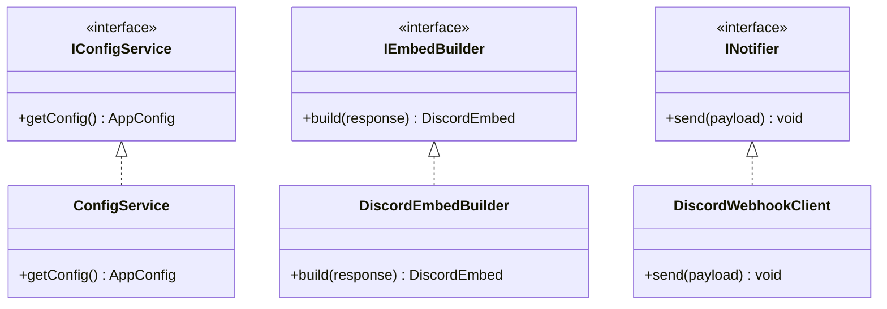

# Ban Appeal Notifier

Google フォームで送信された異議申立て（Ban Appeal）等の回答結果を、Google Apps Script (GAS) を介して Discord Webhook へ即座に通知する自動化ツールです。

プロジェクト内のすべてのスクリプト（ビルドツール含む）は TypeScript で記述されており、SOLID原則およびクリーンアーキテクチャに基づいたエレガントなクラス設計を採用しています。

---

## 概要と特徴

- **完全 TypeScript 開発**: フロントエンド（GAS）からビルドスクリプトまで全コードを TypeScript 化。
- **オブジェクト指向・SOLID原則の徹底**:
  - `IConfigService`: 設定管理の抽象化（`.env` と `PropertiesService` の統合フォールバック）
  - `IEmbedBuilder`: Google フォーム回答から Discord Embed 構造体への高凝集な変換
  - `INotifier`: HTTP リクエストとエラーログ記録・レスポンス検証のカプセル化
- **環境変数の柔軟な管理**: `.env` ファイルによる静的埋め込みと、GAS の `PropertiesService` による動的設定の双方に対応。
- **Google Apps Script & Clasp 連携**: `clasp` を用いた型安全な開発およびデプロイワークフロー。

---

## ディレクトリ構造

```text
Ban-Appeal-Notifier/
├── .env                      # 開発環境用設定ファイル
├── .env.example              # 環境変数テンプレート
├── .clasp.json               # clasp 設定ファイル
├── package.json              # 依存関係およびスクリプト定義
├── tsconfig.json             # TypeScript コンパイラ設定
├── README.md                 # プロジェクト取扱説明書
├── scripts/
│   └── build-config.ts       # .env から src/env.ts を自動生成する TypeScript スクリプト
└── src/
    ├── appsscript.json       # GAS マニフェストファイル
    ├── types.ts              # インターフェースおよび型定義
    ├── env.ts                # (自動生成) 環境定数ファイル
    ├── config.ts             # ConfigService (設定読み込み実装)
    ├── builder.ts            # DiscordEmbedBuilder (Embed 構築実装)
    ├── notifier.ts           # DiscordWebhookClient (Webhook 送信実装)
    └── code.ts               # GAS エントリーポイント (getForms 関数)
```

---

## 事前準備

以下のツールがインストールされていることを確認してください。

- **Node.js** (v18 以上推奨)
- **npm**
- Google アカウントおよび Discord Webhook URL

---

## セットアップ手順

### 1. リポジトリの依存関係インストール

```bash
npm install
```

### 2. 環境変数 (.env) の作成と設定

`.env.example` をコピーして `.env` を作成し、必要な設定値を入力します。

```bash
cp .env.example .env
```

`.env` 内の設定項目:

```env
DISCORD_WEBHOOK_URL=https://discord.com/api/webhooks/YOUR_WEBHOOK_ID/YOUR_WEBHOOK_TOKEN
NONE_TEXT=なし
EMBED_COLOR=8008641
```

- `DISCORD_WEBHOOK_URL`: 送信先の Discord Webhook URL
- `NONE_TEXT`: フォームの未回答項目に対する代替文字列 (デフォルト: "なし")
- `EMBED_COLOR`: Embed の左端ストライプカラー (10進数カラーコード)

---

## ビルドおよびデプロイ

### 1. プロジェクトのビルド

TypeScript ビルドスクリプトを実行し、`.env` から `src/env.ts` を生成した上で `tsc` 型チェックを行います。

```bash
npm run build
```

### 2. Google Apps Script へのプッシュ

`clasp` を利用して GAS プロジェクトへコードを送信します。

```bash
# 必要に応じて clasp へログイン
npx clasp login

# コードのプッシュ
npm run push
```

---

## Google フォーム（GAS）側の設定

1. 対象の Google フォームに紐付く Apps Script エディタを開くか、プッシュ先の GAS プロジェクトを開きます。
2. 左メニューの **トリガー (時計アイコン)** を選択します。
3. **[トリガーを追加]** ボタンをクリックし、以下の通り設定します:
   - **実行する関数を選択**: `getForms`
   - **実行するデプロイを選択**: `Head`
   - **イベントの源泉を選択**: `フォームから`
   - **イベントの種類を選択**: `フォーム送信時`
4. 設定を保存し、アクセス権限を承認します。

---

## 開発・コンポーネント設計方針

本プロジェクトは TypeScript の `namespace` パターン（GAS 環境の単一グローバルスコープとの親和性を担保）およびインターフェース分離設計を採用しています。


